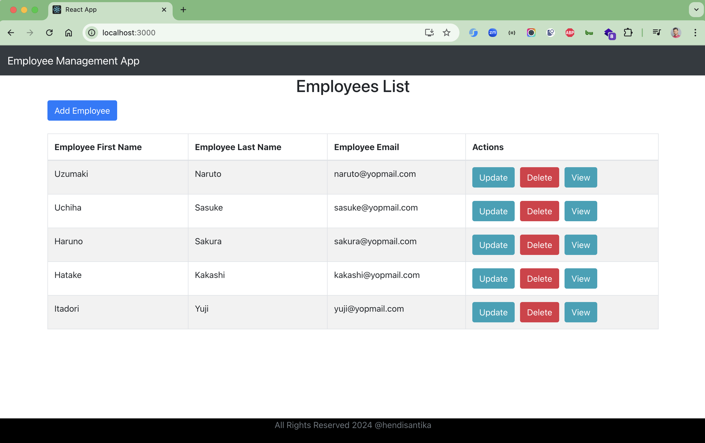
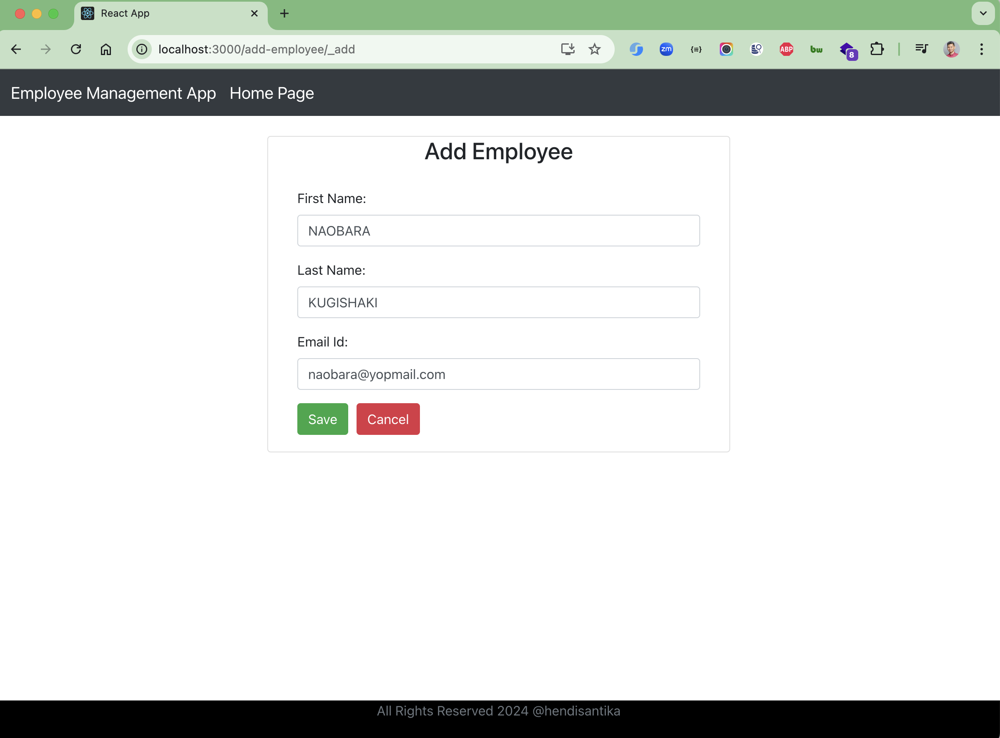
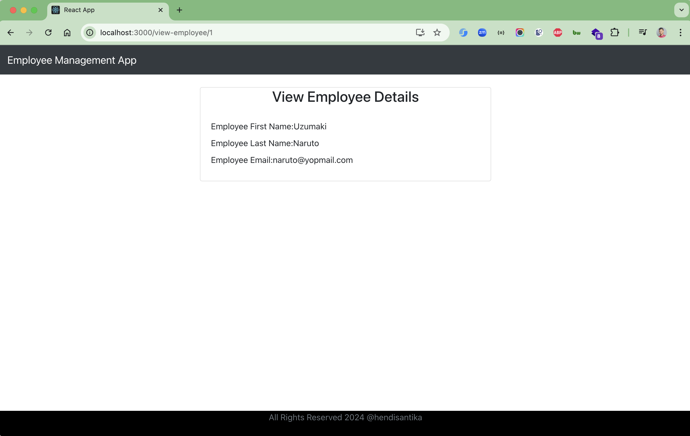
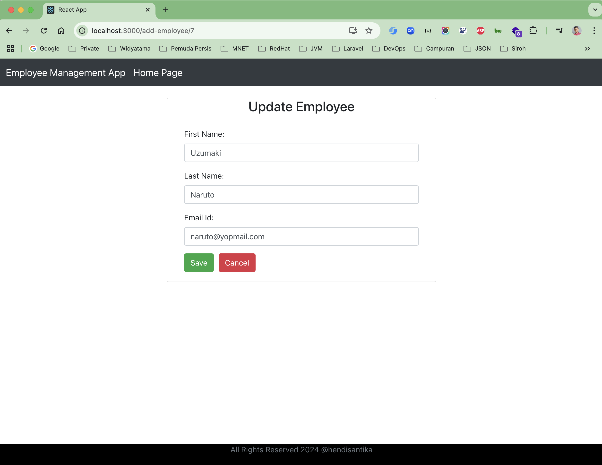

# spring-boot-crud-reactjs-full-stack-app

[](https://github.com/hendisantika/spring-boot-crud-reactjs-full-stack-app/actions/workflows/maven.yml)
[](https://github.com/hendisantika/spring-boot-crud-reactjs-full-stack-app/actions/workflows/nodejs.yml)


Full stack Employee CRUD application with a **Spring Boot** REST API backend and a **React** frontend.

## Tech Stack

| Layer    | Technology                                                       |
|----------|------------------------------------------------------------------|
| Backend  | Java 25, Spring Boot 4.1, Spring Data JPA, Lombok, Maven Wrapper |
| Database | MySQL 9 (via Docker Compose)                                     |
| Frontend | React 19, React Router, Axios, Bootstrap 4 (Create React App)    |
| Tooling  | pnpm 10, Node.js 22/24, Testcontainers, GitHub Actions           |

## Prerequisites

- JDK 25
- Docker (the MySQL container in `compose.yaml` is started automatically by `spring-boot-docker-compose`)
- Node.js 22+ and pnpm 10 (`corepack enable` will pick up the version pinned in `frontend/package.json`)

## Getting Started

1. Clone this repository: `git clone https://github.com/hendisantika/spring-boot-crud-reactjs-full-stack-app.git`
2. Go to the folder: `cd spring-boot-crud-reactjs-full-stack-app`
3. Run the backend: `./mvnw clean spring-boot:run` (API on http://localhost:8080)
4. Go to frontend folder: `cd frontend`
5. Run the frontend: `pnpm install && pnpm start`
6. Open your favorite browser: http://localhost:3000

### Build

```bash
# Backend (jar in target/)
./mvnw -B package

# Frontend (static files in frontend/build/)
cd frontend && pnpm install --frozen-lockfile && pnpm run build
```

## REST API

Base URL: `http://localhost:8080/api/v1/employees`

| Method   | Endpoint                  | Description          |
|----------|---------------------------|----------------------|
| `GET`    | `/api/v1/employees`       | List all employees   |
| `POST`   | `/api/v1/employees`       | Create an employee   |
| `GET`    | `/api/v1/employees/{id}`  | Get employee by id   |
| `PUT`    | `/api/v1/employees/{id}`  | Update an employee   |
| `DELETE` | `/api/v1/employees/{id}`  | Delete an employee   |

## CI/CD & Dependency Updates

- **Java CI with Maven** — builds the backend with Temurin JDK 25 on changes to `src/**` or `pom.xml`.
- **Node.js CI** — installs and builds the frontend with pnpm on Node.js 22.x and 24.x on changes to `frontend/**`.
- **Dependabot** — keeps dependencies up to date with grouped, labeled PRs for:
  - Maven (daily), npm/pnpm in `frontend/`, GitHub Actions and Docker Compose images (weekly).

## Image Screen shot

List All employees



Add New Employee



View Employee



Update Employee


